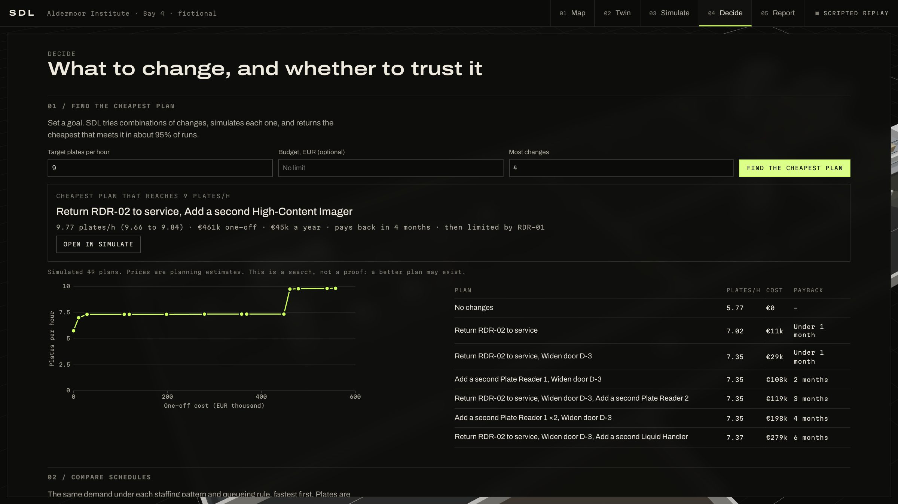

# SDL

**Self-Driving Lab.** An AI agent reads the records a lab already keeps, compiles them into a digital twin where every value cites its source, and lets you simulate a change before you touch a plate.


## What it does

| | |
| --- | --- |
| **Map** | Claude reads floor plans, asset registers, network scans, SOPs and run logs, and finds where they disagree. |
| **Model** | The twin holds geometry, instruments, transport and workflows. Every entity carries evidence, a confidence and a status. |
| **Simulate** | A seeded discrete-event engine runs a day of plates. Scenarios run on the same seeds as the baseline, with one random stream per plate, and report Monte Carlo ranges. |
| **Report** | Every candidate change is ranked by simulated gain, and the report shows where the constraint moves next. |

## The example lab

`examples/aldermoor-bay-4` is a **fictional** lab whose records contradict each other on purpose. Running it shows what SDL produces:

- The register says plate reader RDR-02 is in service. It has been silent for 11 days and went back to the vendor.
- Reads take about 610 s against the 480 s in the SOP, and the SOP claims the arm reaches an imager in another room.
- Restoring the reader gives about **+22%** throughput and moves the bottleneck to the imager.
- Door D-3 really is too narrow for the robot, yet widening it is **within noise**. A flagged problem is not always an expensive one.

- Once the reader is back, widening D-3 becomes a real **+4.6%**, because the imager is then the limit. Only testing changes in combination shows that.
- In the simulated assay, the reader queue leaves about 40% of plates passing Z′ 0.5. The repair takes that to 100%.


## Planning a change

| Where | What it does |
| --- | --- |
| Simulate, left panel | Staffing patterns, queue rules and maintenance windows |
| Simulate, Charts and Tables | Live charts during playback, per-plate results, CSV export |
| Simulate, Assay | Synthetic 384-well plates and dose-response curves, driven by each plate's real wait in the run |
| Simulate, Cost | One-off and yearly cost and payback, with editable assumptions |
| Simulate, Ask | Questions answered from the run's data. Uses Claude if a key is set, otherwise a rule-based engine with no model |
| Decide | Cheapest-plan search, schedule comparison, saved runs side by side, held-out validation |
| Twin, Edit layout | Drag instruments in 3D with reach and collision checks and a live re-simulation |
| Report | Save as PDF, or copy a link that reproduces the scenario |

Prices are round planning estimates, not quotes. Assay readouts are generated, and how much signal is lost to waiting is an assumption. The example's run log comes from a script, so its validation score shows the method working rather than a real lab being predicted.



| Map | Twin | Report |
| --- | --- | --- |
|  |  |  |

## Run it

Requires Node 22 or later.

```bash
npm install
npm run dev
```

Open <http://localhost:3000> for the landing page, or `/console` to watch the example get mapped. The example needs no API key.

### Map your own lab

```bash
cp .env.example .env.local   # then set ANTHROPIC_API_KEY
npm run dev
```

In the console, choose **Map your lab** and upload your files. The key stays on the server. Runs use `claude-opus-5-5` by default; set `SDL_AGENT_MODEL` to change it. A run makes many model calls with high effort, so expect real API cost.

## How it works

```
evidence ──> agent loop (Claude | scripted replay) ──> tool handlers ──> LabTwin (immutable)
                                                           │                  │
                                                     validator, router   simulator (seeded DES)
                                                                              │
                                     console (Map / Twin / Simulate / Report) + landing
```

- **The model decides, the code computes.** Claude reconciles sources. Duration fits, validation, routing and simulation are deterministic code it calls as tools.
- **Citations are checked.** Every entity must cite a loaded document, and any quote it gives must appear in that document. A failing call is rejected and returned to the model to correct. Quotes are optional, so a citation without one is checked for its document only.
- **Evidence is untrusted.** Tools can only change the twin. They have no network or filesystem access.
- **Replay is not Live.** The example is a scripted replay: its decisions are authored, but every call runs through the real tools, validator and simulator, and the console labels it as a replay. No model is called.

| Path | Contents |
| --- | --- |
| `src/core/twin` | Schema, immutable mutations, validator, route planner |
| `src/core/sim` | Discrete-event engine, Monte Carlo, scenarios, improvement path |
| `src/core/agent` | Tool registry, Claude loop, replay |
| `src/components` | 3D scene and console panels |
| `src/app/api/agent` | Streaming Live endpoint |
| `docs/SPEC.md` | Principles, phases, gates, risk register |

## Quality

```bash
npm run verify     # lint, types, unit tests with coverage, build
npm run test:e2e   # Playwright, after a build
```

## Limitations

- **Live mode has not been run against the real Claude API.** The loop has unit tests, and the real SDK and route were exercised against a local stub of the Messages API. How well Claude maps a real lab is unmeasured, and needs an eval set.
- The point cloud in the viewport is **synthesised from the twin**. SDL does not ingest LiDAR or photogrammetry yet. Live mode accepts images, but the example works from text and drawings.
- The simulator is a planning model. It assumes unlimited staging at hand-offs and does not model cost, labour or consumables. Treat results as comparisons, not forecasts.
- Heavy analysis runs on the main thread. The Report view pauses briefly while it computes.
- The Live endpoint's rate limits are in memory, per process. Put real authentication in front of it before deploying it publicly.
- Mobile robot paths minimise distance to each door, not the full path, so a route with several door choices can be slightly longer than optimal.

## License

MIT. Aldermoor Institute is fictional. Its instruments are real commercial products, used by name only to make the example realistic. See [the example README](examples/aldermoor-bay-4/README.md). SDL is not affiliated with or endorsed by their manufacturers.
